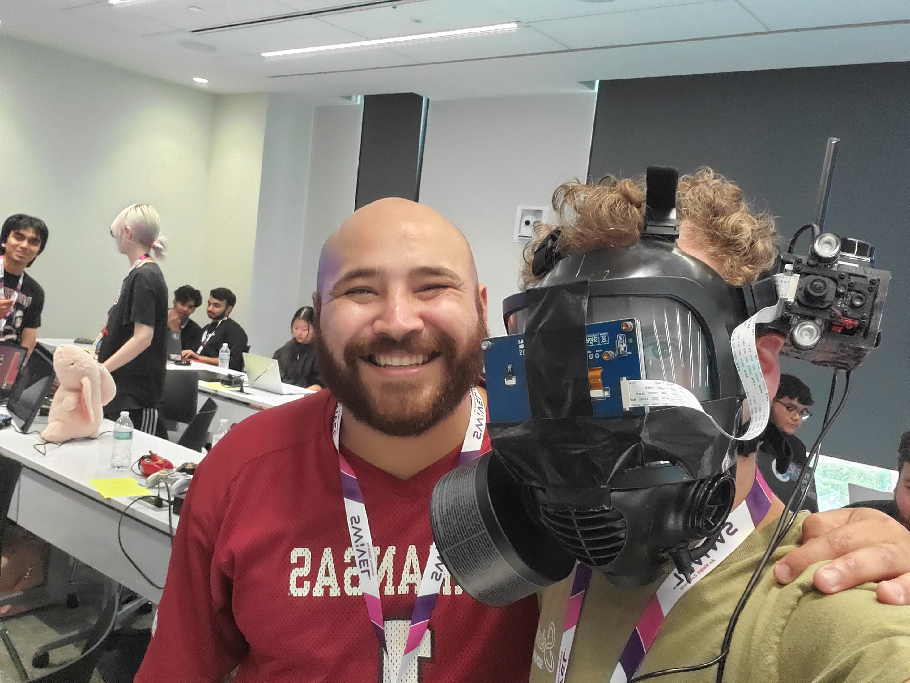
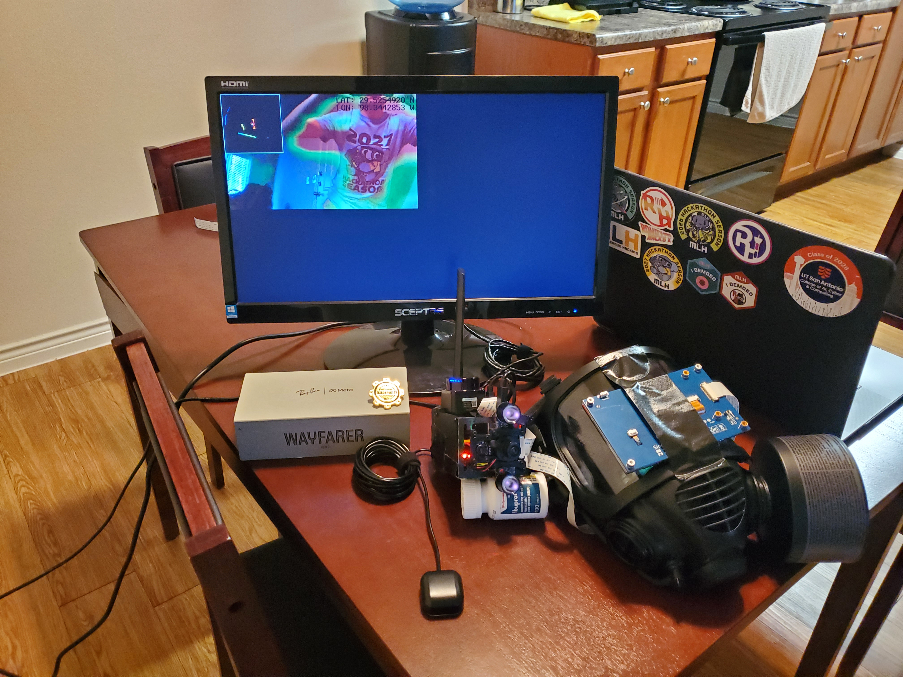
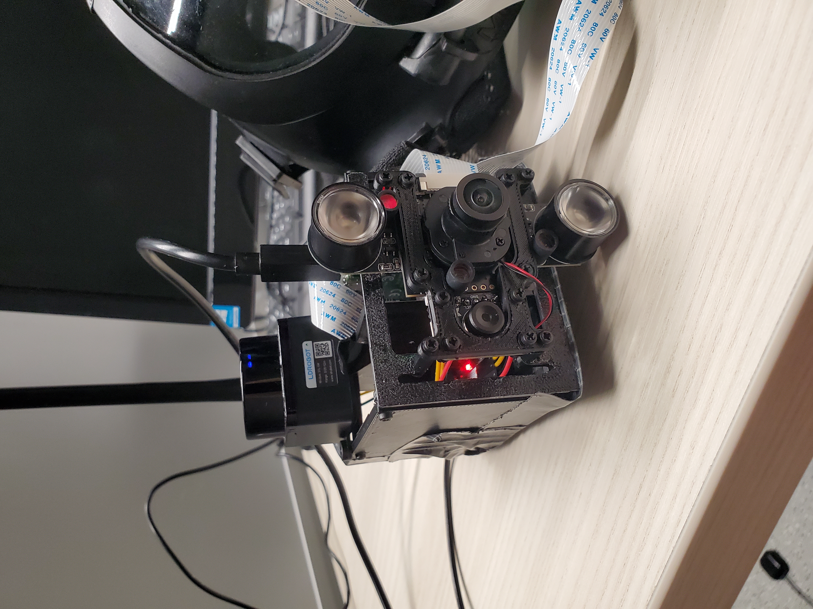
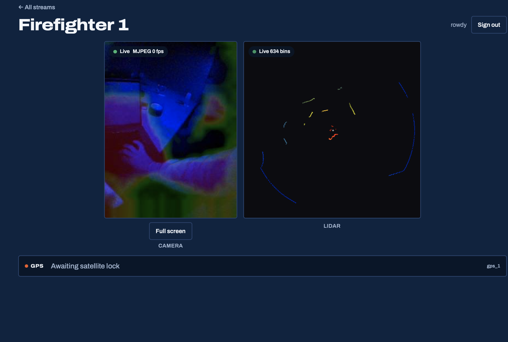
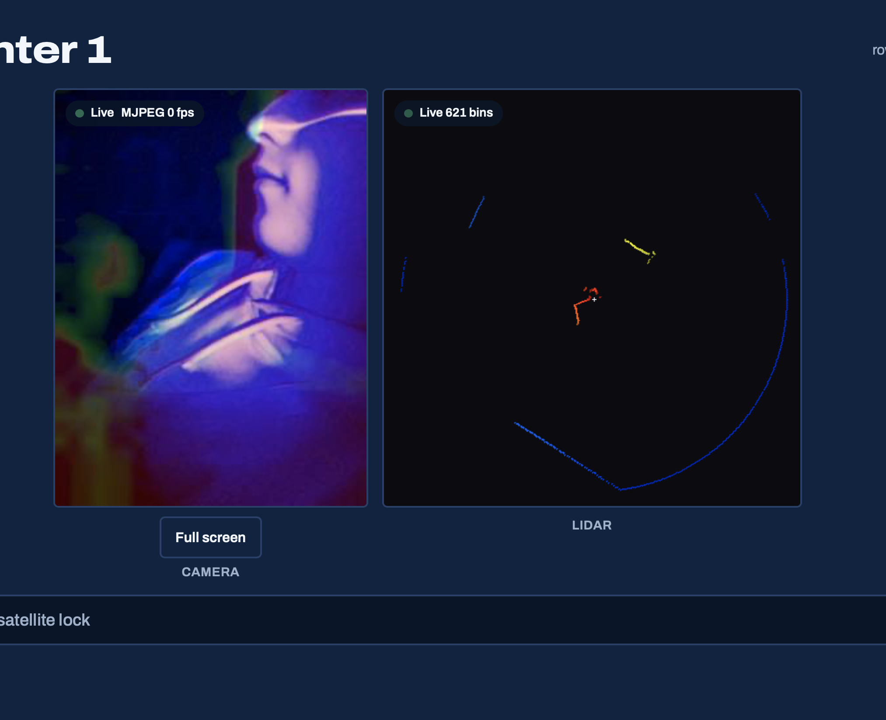
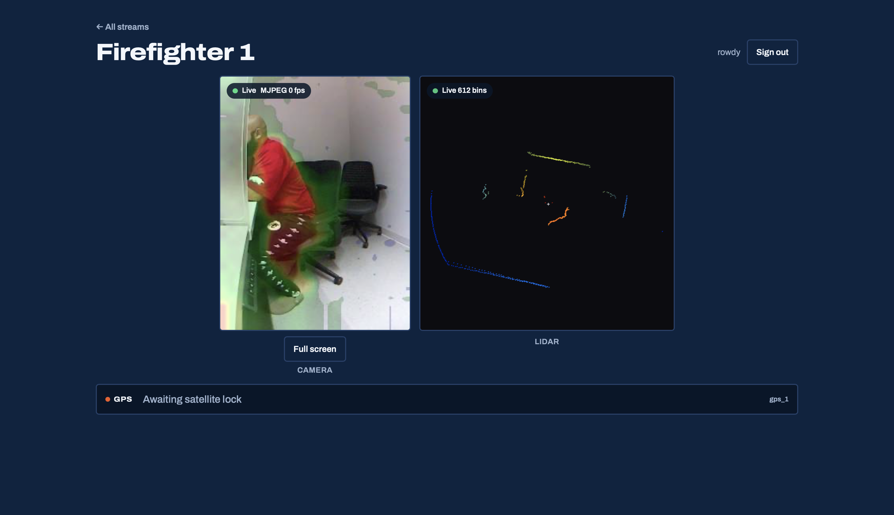
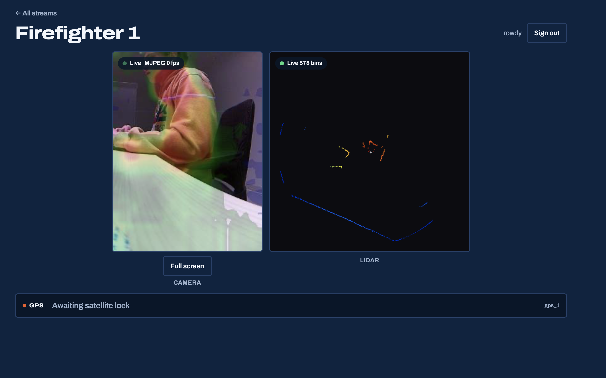
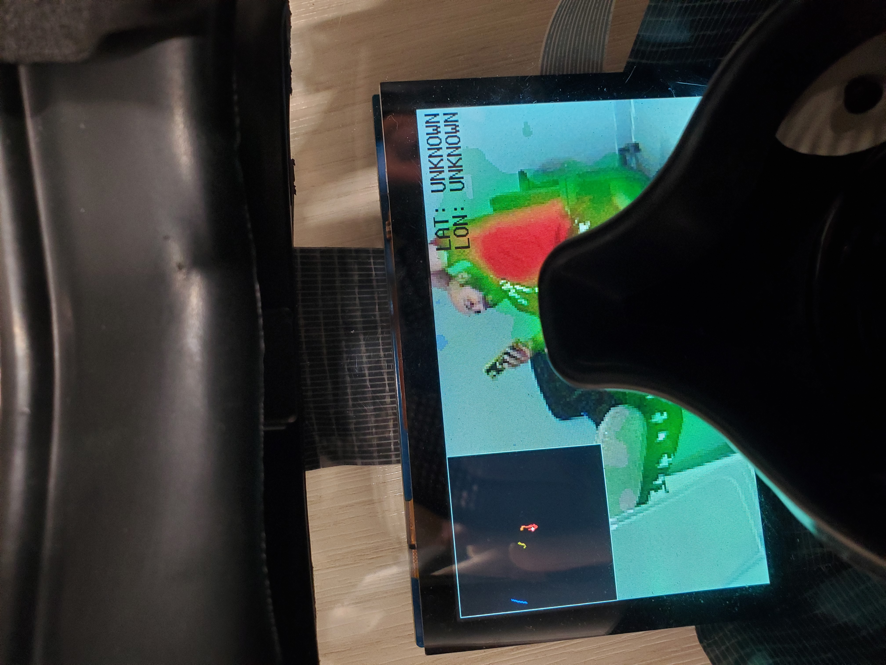
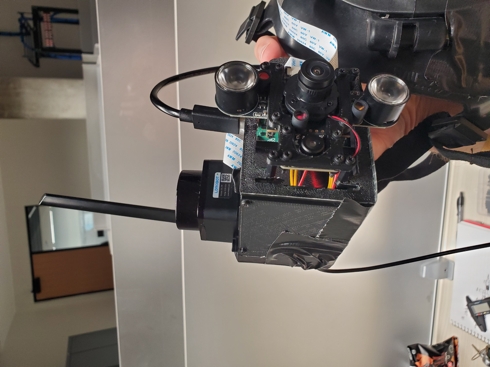

# [FireSight](https://github.com/matthewthomasbeck/RowdyHacks) - RowdyHacks 1st Place
### By [Matthew Beck](https://www.linkedin.com/in/matthewthomasbeck/) and [Matthew Martinez](https://www.linkedin.com/in/matthewmartinez)

**Please consider:** if you like it, **star it!**

## Tech Stack
**Hardware**
- **Raspberry Pi 4** *(edge computer)*
- **Arducam OV5647** *(IR camera)*
- **MLX90640** *(thermal array)*
- **LD19** *(360° lidar)*
- **UART GPS** *(NMEA fixes)*
- **3.5" DSI display** *(on-helmet HUD)*
- **3D-printed mounts** *(optical stack + Pi plate)*

**Software**
- **Edge:** C++17, CMake, libcamera, pthread
- **Cloud:** Python, Flask, Gunicorn, PyJWT (Auth0 JWKS)
- **Front end:** React, Vite, nginx
- **Infra:** AWS EC2, Docker, Tailscale
- **Auth:** Auth0 (user JWTs; edge M2M scaffolding)

## Project Components
| Folder | Role |
| --- | --- |
| `tpu_edge_camera/` | Raspberry Pi firmware: IR + thermal fusion, lidar, GPS, JPEG uplink, framebuffer HUD |
| `ec2_cloud_backend/` | Flask hub: ingest, MJPEG fanout, GPS/lidar JSON, Auth0-gated control plane |
| `web_react_frontend/` | Dispatch SPA at [firesight.casa](https://firesight.casa): stream pick, fused video, lidar, GPS |
| `3d_parts/` | STL mounts for the wearable optical and Pi stack |

## Roles
**Matthew Beck ([LinkedIn](https://www.linkedin.com/in/matthewthomasbeck/) | [GitHub](https://github.com/matthewthomasbeck) | [Website](https://www.matthewthomasbeck.com)):**
- Software Architect *(edge/cloud/front-end contract, Auth0 audiences, deploy path to EC2 + firesight.casa)*
- Edge Firmware *(C++17 fusion pipeline, async thermal reader, JPEG keep-alive uplink, DSI HUD)*
- Cloud + Front End *(Flask ingest/MJPEG store, React dispatch watch view, nginx proxy)*

**Matthew Martinez ([LinkedIn](https://www.linkedin.com/in/matthewmartinez)):**
- Domain + Hardware *(firefighter ops insight, wearable mask integration, sensor mounting and field demo)*
- Systems Integrator *(lidar/GPS bring-up, power and cabling, live dual-firefighter demo)*

## Overview
FireSight is a wearable firefighter monitoring system built for RowdyHacks. A Raspberry Pi on the mask fuses infrared and thermal video on-device into a predator-style frame, overlays 360° lidar and GPS, and pushes live JPEG plus telemetry to a Flask hub on AWS EC2. Dispatchers watch Firefighter 1 / Firefighter 2 streams at [firesight.casa](https://firesight.casa): fused heat vision, a lidar map, and GPS in one composition.

  
  

The stack is three systems that only meet at HTTP. Edge firmware owns sensors and fusion. EC2 owns the latest frame, GPS, and lidar per firefighter. The React SPA only talks to the backend: MJPEG for video, polled JSON for lidar and GPS. nginx serves the SPA and reverse-proxies `/api/` to Flask so the site stays same-origin.

  
  

On the Pi, an async MLX90640 reader keeps thermal (~16 Hz) from gating IR, so fusion can target ~20 FPS. A worker thread posts raw JPEG over HTTP keep-alive so uplink RTT does not stall the optional framebuffer HUD. Missing sensors fall back to demo drivers so the pipeline still runs when a cable fails.

  
  

Custom 3D-printed plates hold the optical assembly and Pi on the mask. The live path is push-from-edge ingest (`POST /api/v1/ingest/...`) and MJPEG fanout, not cloud pull. Auth0 JWKS validates dispatcher JWTs on control-plane routes; edge M2M tokens are scaffolded for device uplink.

  
  

## Try it
1. Open [firesight.casa](https://firesight.casa).
2. Sign in when prompted.
3. Pick Firefighter 1 or Firefighter 2.
4. Watch fused IR+thermal video, lidar, and GPS.

*Live feeds depend on edge devices being powered and uplinking.*
